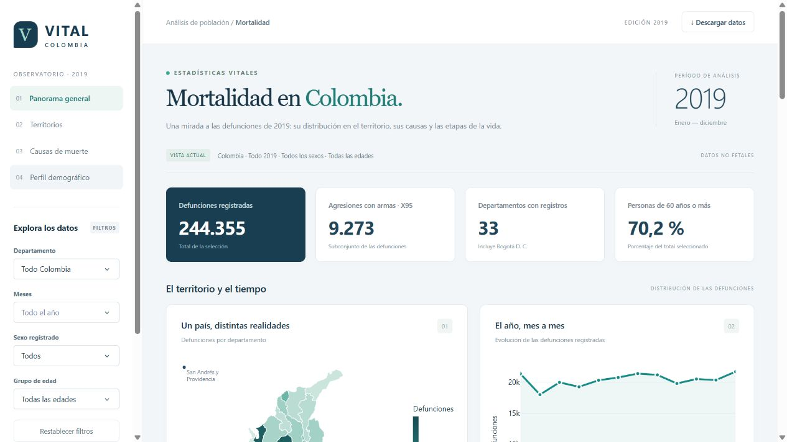
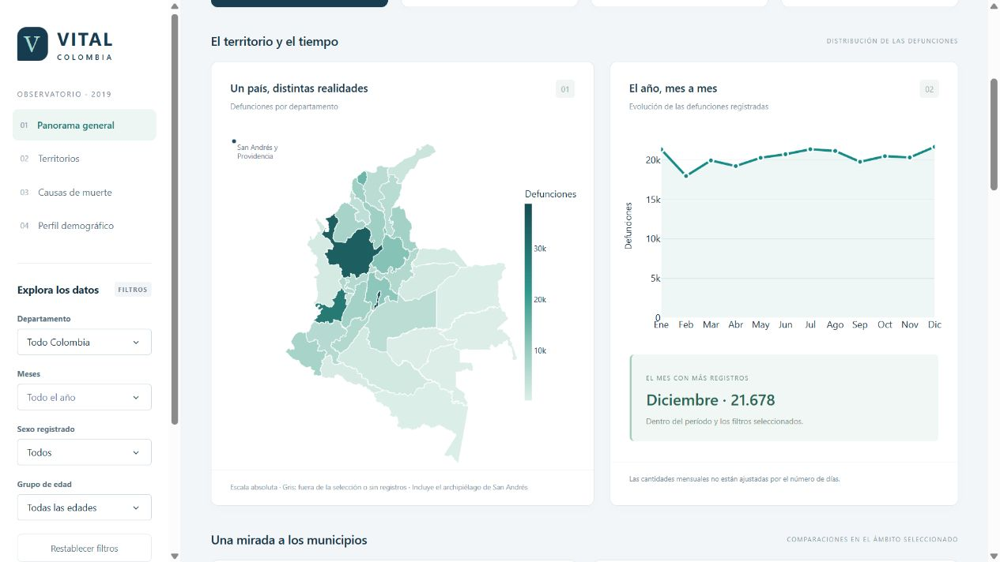
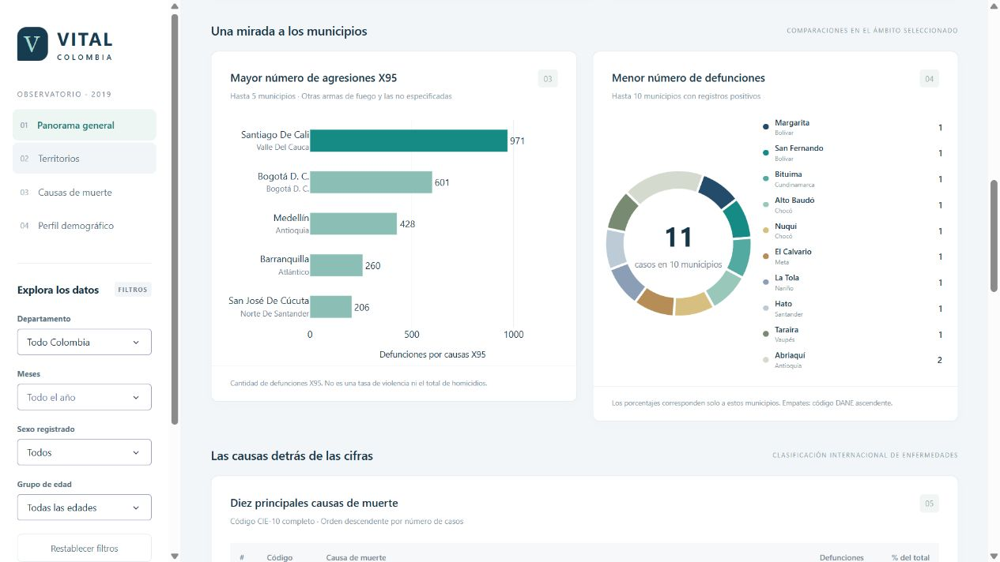
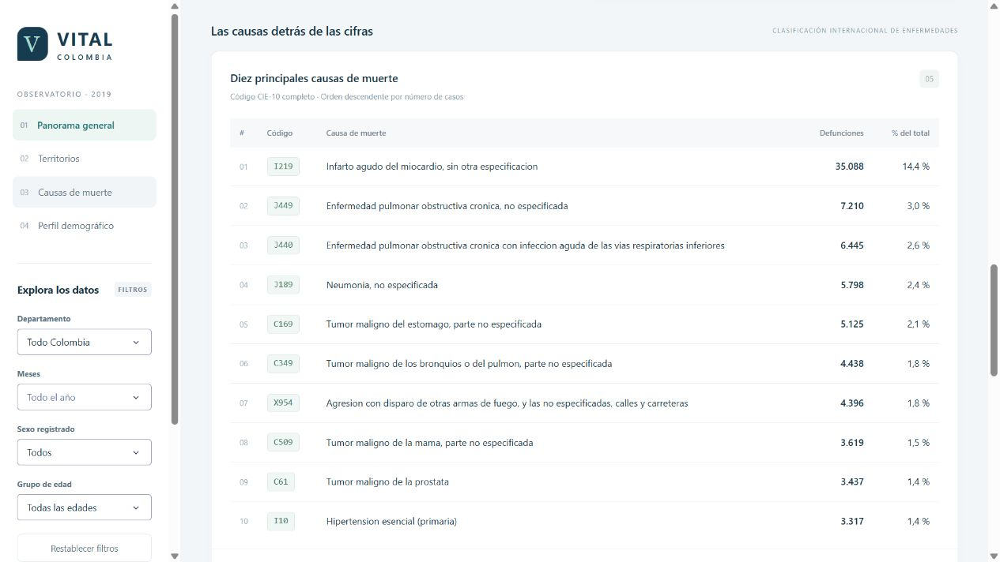
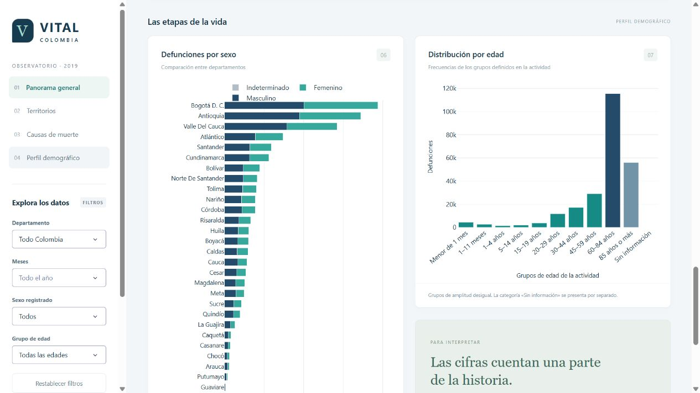
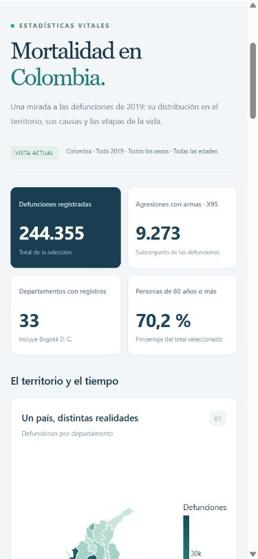

# Vital Colombia · Mortalidad 2019

Aplicación web interactiva para explorar **244.355 defunciones no fetales registradas
en Colombia durante 2019**, desarrollada con Python, Dash y Plotly para la Actividad 4.

**Estado:** desarrollo y ejecución local verificados. El repositorio de GitHub ya está creado; la subida de los archivos y el despliegue en Render gratuito están pendientes. La URL pública se añadirá después de verificar el despliegue.

## Introducción del proyecto

Vital Colombia reúne la distribución territorial y mensual de las defunciones,
las causas de muerte y el perfil por sexo y edad en un tablero interactivo.
Integra los tres anexos académicos, conserva los registros originales y presenta
criterios de interpretación junto a cada visualización.

## Objetivo

Facilitar la exploración de patrones demográficos y territoriales de mortalidad no
fetal en 2019, mediante siete visualizaciones coordinadas y filtros reproducibles.
El análisis es descriptivo: los conteos no permiten establecer causalidad ni
comparar riesgos sin información poblacional adicional.

## Funcionalidades

| Visualización | Cálculo |
|---|---|
| Mapa departamental | Suma de defunciones por código de departamento, incluyendo Bogotá D. C. |
| Línea mensual | Suma por mes, en orden de enero a diciembre o por los meses seleccionados. |
| Barras de agresiones X95 | Hasta cinco municipios con más defunciones cuyo código comienza por `X95`. |
| Circular de menor mortalidad | Hasta diez municipios con menor **cantidad positiva** de defunciones. |
| Tabla de causas | Diez códigos completos de `COD_MUERTE` con más casos y su descripción CIE-10. |
| Barras apiladas | Defunciones por departamento y sexo registrado. |
| Histograma agrupado | Frecuencias de las categorías académicas construidas desde `GRUPO_EDAD1`. |

- Filtros por departamento, meses, sexo y grupo de edad.
- Indicadores de total, casos X95, departamentos con registros y proporción de 60 años o más.
- Restablecimiento de la vista nacional y mensajes para selecciones sin registros.
- Información al pasar el cursor y descarga de gráficas mediante Plotly.
- Descarga CSV de la selección, con códigos geográficos y conteos agregados.
- Diseño adaptable a computador y móvil, navegación por secciones y acceso por teclado.
- Fuentes, alcance y metodología dentro del dashboard.

## Estructura del proyecto

```text
Actividad4/
├── src/
│   ├── app.py                  # Fábrica Dash y punto de entrada local
│   ├── layout.py               # Interfaz y contexto metodológico
│   ├── callbacks.py            # Eventos, filtros, actualización y exportación
│   ├── analytics.py            # Cálculos puros y reglas de selección
│   ├── figures.py              # Construcción de gráficas Plotly
│   ├── settings.py             # Rutas, diccionarios y grupos de edad
│   ├── components/
│   │   └── cards.py            # Paneles, indicadores y componente gráfico
│   └── data/
│       ├── preparation.py      # Lectura, validación, cruces y agregación
│       └── repository.py       # Carga única y acceso de solo lectura
├── assets/
│   ├── style.css               # Estilo visual y puntos de adaptación
│   └── geo/world_110m.json      # Base cartográfica local para Plotly
├── data/
│   ├── raw/                    # Ubicación alternativa de los Excel originales
│   ├── processed/
│   │   ├── mortality.csv.gz     # Frecuencias por dimensiones; no una muestra
│   │   ├── territories.csv     # Catálogo territorial normalizado
│   │   ├── causes.json         # Diccionario CIE-10
│   │   └── quality_report.json # Totales, controles y huellas SHA-256
│   └── geo/
│       ├── departments_2019.geojson
│       └── source.json         # Procedencia y parámetros de la cartografía
├── scripts/
│   ├── prepare_data.py         # Regeneración reproducible desde los Excel
│   └── fetch_geography.py      # Descarga de cartografía pública
├── tests/                      # Pruebas analíticas y de integración HTTP
├── docs/screenshots/           # Capturas reales del dashboard
├── requirements.txt            # Dependencias directas de ejecución
├── requirements-dev.txt        # Dependencias de pruebas
├── requirements-lock.txt       # Versiones completas del entorno verificado
├── pyproject.toml              # Configuración de pruebas
├── .gitignore
└── README.md
```

Los tres Excel recibidos se mantienen en su ubicación original, en la raíz, sin
modificarlos. El lector también admite `data/raw/`. Si existen en ambas ubicaciones,
se prioriza `data/raw/`. Los tres Excel originales se incluyen para reproducir la preparación de datos. El entorno `.venv/` y los archivos temporales se excluyen del control de versiones.

## Requisitos y software

Probado con **Python 3.12.14**. Se recomienda Python 3.12 para reproducir este entorno.

| Herramienta | Versión | Función |
|---|---|---|
| Dash | 4.5.0 | Aplicación web, componentes y callbacks |
| Plotly | 7.1.0 | Gráficas interactivas |
| pandas | 3.1.0 | Validación, cruces, filtros y agregaciones |
| openpyxl | 3.1.5 | Lectura de los Excel originales |
| Waitress | 3.0.2 | Servidor WSGI opcional para ejecución local |
| pytest | 9.2.0 | Pruebas automatizadas |

La interfaz utiliza CSS propio y fuentes del sistema. Las gráficas, catálogos y
mapas se sirven desde el proyecto: **la consulta del tablero no necesita Internet**
una vez instaladas las dependencias y preparados los recursos. Los enlaces a las
fuentes oficiales sí requieren conexión.

## Instalación

### En esta carpeta, con el entorno ya creado

Abra una terminal en la raíz del proyecto y ejecute:

```powershell
.\.venv\Scripts\python.exe -m src.app
```

Abra [http://127.0.0.1:8050](http://127.0.0.1:8050). Detenga el servidor con `Ctrl+C`.
No es necesario activar el entorno ni cambiar las políticas de PowerShell.

### Crear el entorno en otra máquina

Repositorio: [SergioPenaloza/mortalidad-colombia-2019](https://github.com/SergioPenaloza/mortalidad-colombia-2019). Una vez cargados los archivos, clone el repositorio o descargue y extraiga su ZIP; luego entre en la carpeta del proyecto.

```powershell
python -m venv .venv
.\.venv\Scripts\python.exe -m pip install -r requirements-dev.txt
.\.venv\Scripts\python.exe -m src.app
```

Para reproducir todas las versiones verificadas puede instalar
`requirements-lock.txt` en lugar de `requirements-dev.txt`.
En macOS/Linux, sustituya `.\.venv\Scripts\python.exe` por `.venv/bin/python`.
El entorno virtual es exclusivo de este proyecto, no debe subirse a Git ni copiarse
a otra computadora: se recrea a partir de las dependencias.

### Reconstruir los datos

Si faltan los archivos procesados o cambian los Excel, coloque los tres originales
en la raíz o en `data/raw/` y ejecute:

```powershell
.\.venv\Scripts\python.exe -m scripts.prepare_data
```

El proceso lee solo `No_Fetales_2019`, el catálogo `Final` desde su fila 9 y las hojas
relevantes de Divipola. Ignora la hoja auxiliar del archivo de mortalidad.

La cartografía está incluida. Solo si necesita reconstruirla, ejecute con conexión:

```powershell
.\.venv\Scripts\python.exe -m scripts.fetch_geography
```

Reinicie el servidor después de reconstruir datos o modificar Python. Para desarrollo
con recarga automática puede establecer `$env:DASH_DEBUG="1"` antes de ejecutar
`python -m src.app`; el modo normal mantiene la depuración desactivada.

### Servidor local WSGI opcional

```powershell
.\.venv\Scripts\waitress-serve.exe --listen=127.0.0.1:8050 src.app:server
```

Esta alternativa también permanece en el computador local. La ruta `/health`
devuelve el estado del servicio, el año y el total de registros cargados.

## Datos y metodología

### Fuentes

1. `Anexo1.NoFetal2019_CE_15-03-23.xlsx`: 244.355 registros de 2019, 16 columnas.
2. `Anexo2.CodigosDeMuerte_CE_15-03-23.xlsx`: catálogo CIE-10 de tres y cuatro caracteres.
3. `Divipola_CE_.xlsx`: nombres, códigos y tipos territoriales.
4. [DANE: Estadísticas Vitales 2019](https://microdatos.dane.gov.co/index.php/catalog/696): diccionario y contexto de la operación.
5. [DANE: capa Departamento del servicio MGN2019](https://portalgis.dane.gov.co/mparcgis/rest/services/MGN2019/Serv_CapasMGN_2019/FeatureServer/319): polígonos del mapa.

Fuente: Departamento Administrativo Nacional de Estadística — www.dane.gov.co.
Aplicación académica independiente; no es un producto oficial del DANE.

### Decisiones explícitas

- **Cantidad, no tasa:** no se dispone de denominadores poblacionales. El requisito
  «menor índice de mortalidad» se implementa como menor número positivo de defunciones,
  con esa denominación visible. Si el docente exige tasas, se necesitará población
  municipal 2019 y un numerador territorial compatible.
- **Territorio:** se agrupa por los códigos suministrados en el anexo. Su estructura
  es compatible con ocurrencia de la defunción, pero la adaptación no incluye una
  etiqueta de residencia o de lugar del hecho violento que permita intercambiarlos.
  Los resultados no se presentan como riesgo de los habitantes ni localización de la agresión.
- **Municipios:** ambos rankings usan exclusivamente `territory_type = Municipio`
  según la segunda hoja de Divipola. Se excluyen áreas no municipalizadas e islas de
  los rankings, pero se conservan sus registros en los totales y demás gráficos.
- **Ceros y empates:** solo se clasifican municipios con registros positivos en la
  selección. Ausencia de registros no equivale a ausencia de muertes. Desempate por
  código DANE ascendente, con un máximo de 5 o 10 municipios.
- **X95:** filtro por prefijo del código normalizado, incluyendo `X950` a `X959`.
  No se amplía a todos los homicidios ni a otras causas con armas de fuego.
- **Causas:** se conserva el código completo de `COD_MUERTE`; no se mezclan categorías
  de tres caracteres con subcategorías para elaborar el ranking. El catálogo se
  transforma en un diccionario para evitar multiplicar registros durante el cruce.
- **Sexo:** 1 masculino, 2 femenino y 3 indeterminado. Los 93 casos indeterminados se conservan.
- **Edades:** los 23 casos de edad desconocida permanecen separados. El indicador de
  60 años o más divide los códigos 20–28 entre el total seleccionado, incluida edad desconocida.
- **Meses:** selección vacía significa todo el año. Los meses no seleccionados no se
  dibujan como ceros; los meses seleccionados sin registros sí muestran frecuencia cero.
- **Circular:** sus porcentajes suman 100 % dentro del grupo de municipios mostrado,
  no dentro de Colombia. Si no hay registros, se muestra un mensaje y no una torta ficticia.
- **Cartografía:** el servicio público se denomina MGN2019, pero el atributo `DPTO_NANO`
  indica 2018 en sus polígonos. Se conserva ese dato de procedencia. Los 33 códigos
  coinciden con los del anexo. La geometría se generaliza a 0,008 grados para visualizarla,
  sin modificar conteos. El renderizador adapta la orientación de anillos a D3 sin
  alterar el GeoJSON fuente. No sustituye cartografía legal.

### Grupos de edad

| Categoría académica | Códigos `GRUPO_EDAD1` | Rango |
|---|---|---|
| Neonatal | 0–4 | Menor de 1 mes |
| Infantil | 5–6 | 1–11 meses |
| Primera infancia | 7–8 | 1–4 años |
| Niñez | 9–10 | 5–14 años |
| Adolescencia | 11 | 15–19 años |
| Juventud | 12–13 | 20–29 años |
| Adultez temprana | 14–16 | 30–44 años |
| Adultez intermedia | 17–19 | 45–59 años |
| Vejez | 20–24 | 60–84 años |
| Longevidad / Centenarios | 25–28 | 85 años o más |
| Edad desconocida | 29 | Sin información |

El histograma se representa con barras de frecuencias de estas categorías ordenadas.
Los intervalos son desiguales y el último es abierto: la altura muestra cantidad,
no densidad por año de edad. Se mantienen las etiquetas de la actividad, sin
presentarlas como definiciones de tasas neonatal o infantil.

### Calidad y rendimiento

- Todos los registros corresponden a 2019; se validan meses 1–12, sexo 1–3 y edades 0–29.
- Los códigos geográficos mantienen ceros iniciales y se valida su concatenación.
- Todos los códigos de la base tienen correspondencia territorial y descripción de causa.
- Existe un vacío en `ESTADO_CIVIL`, que no interviene en los cálculos del tablero.
- No se eliminan filas repetidas: pueden representar fallecimientos diferentes.
- La agregación genera 201.050 combinaciones con una columna de frecuencias cuya
  suma sigue siendo 244.355. No se utiliza muestreo.
- Los datos enriquecidos ocupan aproximadamente 4 MiB en pandas en el entorno
  verificado; no es una medida de la memoria total del proceso Python.
- Se carga una vez por proceso y los filtros no modifican el conjunto compartido.
- `quality_report.json` conserva totales y huellas SHA-256 de los originales. Si
  cambian las fuentes, es necesario regenerar y reiniciar; no se detectan cambios
  automáticamente durante una sesión.

## Visualizaciones y explicación de los resultados

Las capturas siguientes muestran la vista nacional, sin filtros, con datos reales.
También puede consultar la [captura completa del tablero](docs/screenshots/dashboard-completo.jpg).

### Panorama, mapa y evolución mensual





- Bogotá D. C. registra 38.760 defunciones, Antioquia 34.473 y Valle del Cauca 28.443.
  Son cantidades atribuidas a los códigos territoriales del anexo, no tasas poblacionales.
- Diciembre presenta el mayor conteo mensual: 21.678. Febrero presenta 17.974.
  La comparación no ajusta por la distinta duración de los meses.

### Comparaciones municipales



Las cinco mayores cantidades X95 corresponden a Santiago de Cali (971), Bogotá D. C.
(601), Medellín (428), Barranquilla (260) y San José de Cúcuta (206). La base contiene
9.273 casos X95 en total. El ranking no representa todos los homicidios.

El grupo de diez municipios con menores conteos positivos suma 11 defunciones:
nueve municipios tienen un registro y el décimo tiene dos. Existen empates y se
resuelven por código DANE. No se concluye que esos municipios sean los de menor riesgo.

### Causas de muerte



`I219`, infarto agudo del miocardio sin otra especificación, encabeza la tabla con
35.088 registros (14,4 % del total). Le siguen `J449` con 7.210 y `J440` con 6.445.
Son códigos completos; unirlos por categorías generales cambiaría el ranking.

### Sexo y ciclo de vida



Se registran 134.573 defunciones masculinas, 109.689 femeninas y 93 de sexo indeterminado.
El grupo de 60–84 años reúne 115.453 registros y el de 85 años o más, 56.061.
En conjunto, las personas de 60 años o más representan el 70,2 % de los registros.
Estas diferencias describen la distribución de fallecimientos, no riesgos ajustados
por edad ni por población.

## Pruebas y verificación

```powershell
.\.venv\Scripts\python.exe -m pytest
.\.venv\Scripts\python.exe -m pip check
```

Las pruebas cubren conservación de totales, claves geográficas, códigos desconocidos,
partición de edades, filtros combinados, empates, exclusión de áreas no municipales
en rankings, mapa y orientación de polígonos, estados vacíos y llamadas HTTP reales
al endpoint de callbacks de Dash. También verifican el CSV y el restablecimiento.

Las pruebas HTTP usan el cliente de Flask, sin abrir un puerto. Complementan la
revisión manual en navegador; no sustituyen una prueba visual de la interfaz.

Verificación de esta versión: **20 pruebas aprobadas**, dependencias consistentes,
revisión visual de las siete vistas y de la versión móvil a 390 px, filtro Bogotá
(38.760), filtro febrero (17.974), restablecimiento nacional y descarga real de un
CSV filtrado. No se observaron errores nuevos en la consola tras las correcciones.



## Despliegue en Render gratuito — pendiente

La plataforma elegida es **Render**, mediante un **Web Service con el plan Free**.
El repositorio [SergioPenaloza/mortalidad-colombia-2019](https://github.com/SergioPenaloza/mortalidad-colombia-2019)
ya está creado. La subida de los archivos y el despliegue están pendientes;
la aplicación todavía no cuenta con una URL pública verificada.

Pasos pendientes:

1. Subir al repositorio el código, los tres Excel originales, los datos procesados,
   los recursos cartográficos y la documentación.
2. Conectar el repositorio a un Web Service de Render y seleccionar el plan Free.
3. Configurar la versión de Python, la instalación de dependencias y el comando
   de arranque con `src.app:server`, el puerto indicado por Render y la depuración
   desactivada. Esta configuración aún no se ha aplicado ni validado en la nube.
4. Verificar las siete visualizaciones, los filtros, la descarga CSV y `/health`
   desde la URL pública asignada por Render.
5. Añadir la URL pública y los pasos efectivamente realizados a este README
   para completar la entrega académica.

## Entrega académica

- **Integrante:** Sergio Alejandro Peñaloza Gelves.
- **URL pública PaaS:** pendiente del despliegue y la verificación en Render gratuito.
- **URL del repositorio GitHub:** [mortalidad-colombia-2019](https://github.com/SergioPenaloza/mortalidad-colombia-2019).
- **Evidencia:** capturas y resultados incluidos en este documento.

## Referencias técnicas

- Material suministrado: unidad 3.3 (Dash y callbacks) y unidad 3.6 (despliegue PaaS).
- [Documentación de Dash](https://dash.plotly.com/)
- [Callbacks de Dash](https://dash.plotly.com/basic-callbacks)
- [Mapas coropléticos de Plotly](https://plotly.com/python/choropleth-maps/)
- [Diccionario DANE de edades](https://microdatos.dane.gov.co/index.php/catalog/696/variable/F23/V1350?name=GRU_ED1)
- [Diccionario DANE de sexo](https://microdatos.dane.gov.co/index.php/catalog/696/variable/F23/V1348?name=SEXO)
